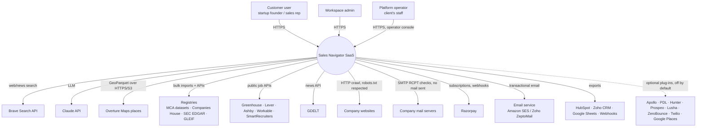
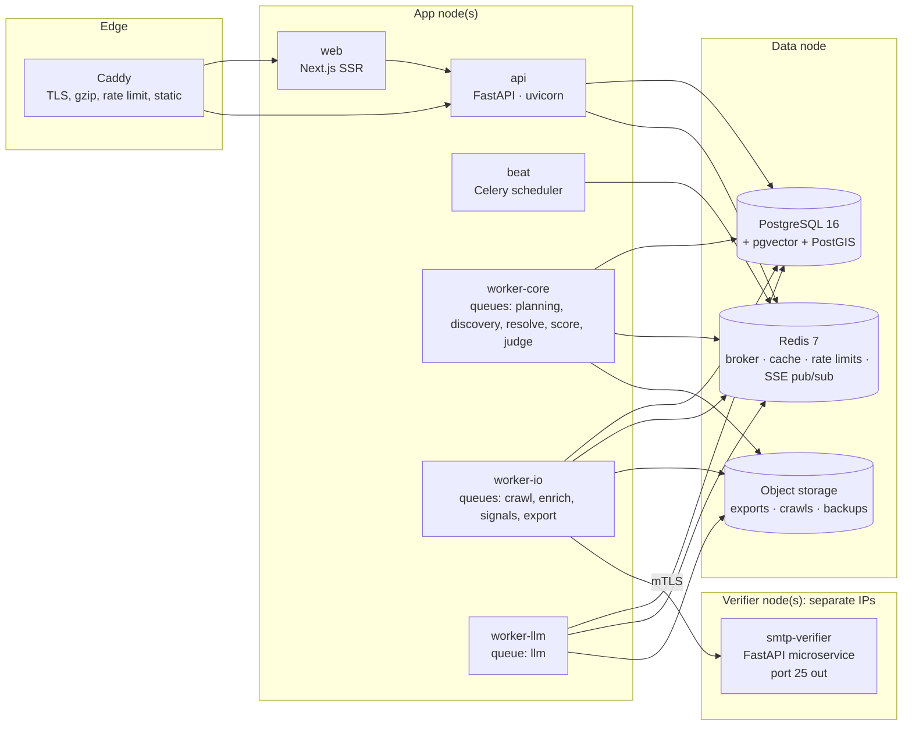
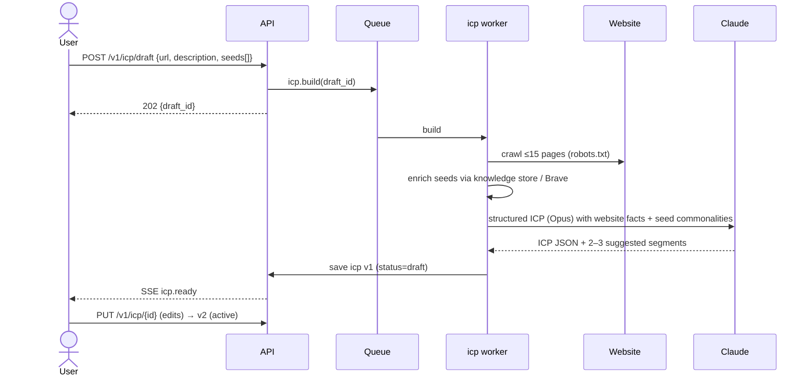
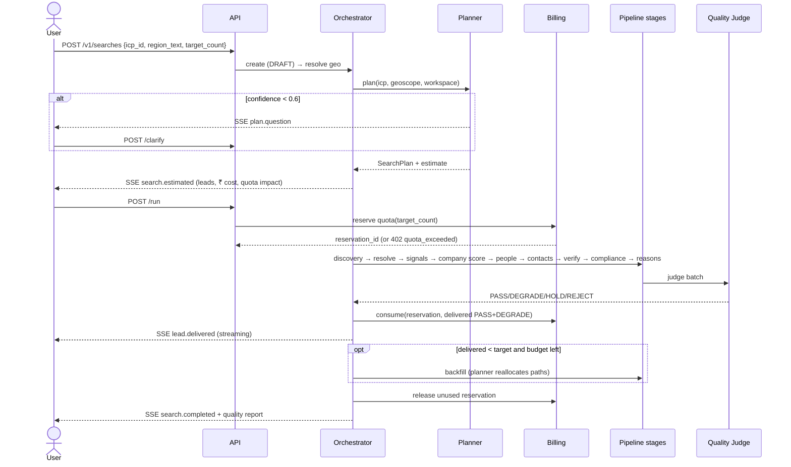
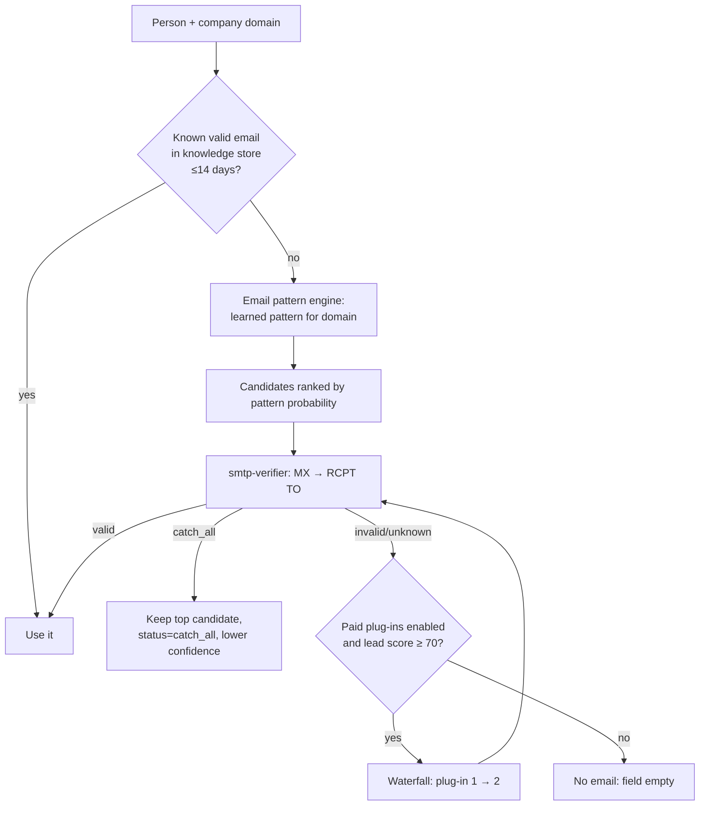
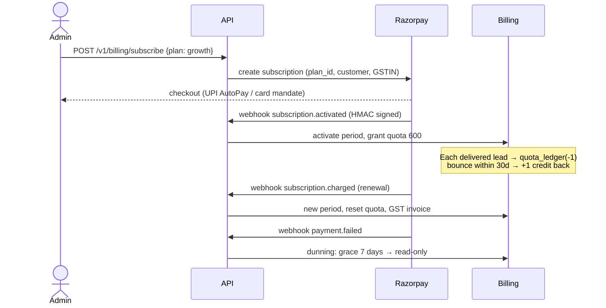

# Sales Navigator: High-Level Design (HLD)

**Version:** 1.0 · **Date:** 2026-11-10 · **Status:** Baseline for implementation
**Companion docs:** [SYSTEM_DESIGN.md](SYSTEM_DESIGN.md) (reasoning and decisions), [LLD.md](LLD.md) (implementation detail)

> **This document supersedes SYSTEM_DESIGN.md wherever they differ.** The main differences: free-first data sources (Brave + open data + our own email engine), with paid providers as optional plug-ins. Multi-tenant SaaS with subscription billing for the Indian market. A shared global knowledge store (§7.2).

---

## 1. Purpose and scope

Sales Navigator is a **multi-tenant SaaS** that helps startup founders and small businesses find **customers** in any region (global, country, state, city, radius). For each lead it returns:
- a matching company,
- the right decision-maker,
- verified ways to contact them (work email, LinkedIn URL, business/mobile phone, WhatsApp Business),
- a **fit score with reasons backed by evidence**.

**In scope:** customer profile (ICP) generation, region resolution, path planning, discovery, enrichment, contact finding and checking, scoring, quality judging, subscriptions and billing (₹, GST), exports and CRM sync, compliance, admin and operator consoles.

**Out of scope (v1):** sending email or WhatsApp campaigns, a dialler, a mobile app, consumer-level (B2C individual) contact data.

### 1.1 Business context
| Item | Value |
|---|---|
| Operator | The client company that buys the source code and runs the SaaS |
| End users | Startup founders and owners of B2B/B2C businesses, mainly in India |
| Scale target | 100 → 500 customer accounts. ~450 delivered leads per account per month |
| Plans | Trial (25 leads), Starter ₹1,999 (150), Growth ₹5,999 (600), Pro ₹14,999 (1,500), Enterprise (custom). Prices before 18% GST |
| Team running it | 1 in-house developer (₹50k/month) + the seller's maintenance retainer |

### 1.2 Quality attributes (in priority order)
1. **Correctness / fairness:** only confident output is delivered and billed.
2. **Low cost per lead:** ≤ ₹5 in the default free-first mode.
3. **Simple to operate:** one developer can run it.
4. **Legally clean:** licensed or open data only. DPDP / TRAI / GST compliant.
5. **Extensible:** new data sources are plug-ins.

---

## 2. System context (C4 level 1)



---

## 3. Architectural style

**A modular monolith with asynchronous workers**, not microservices.

| Option | Verdict | Why |
|---|---|---|
| Microservices | ❌ | One developer cannot run 15 services, distributed tracing, service mesh and multiple pipelines |
| **Modular monolith + worker pools** | ✅ | One codebase and one deploy. Modules talk through in-process interfaces, and heavy work goes through queues. Any module can be split out later if needed |
| Serverless | ❌ | Long-running crawls and SMTP sessions, cold starts, vendor lock-in |

**Rules that keep it modular:**
- Each module owns its own tables and exposes a `service.py` interface. Other modules never query its tables directly.
- Cross-module side effects go through **domain events** (an outbox table → Redis stream), e.g. `LeadDelivered → Billing consumes quota`.
- An import-linter contract in CI blocks forbidden imports between modules.

---

## 4. Containers (C4 level 2)



| Container | Tech | Responsibility | Scaling |
|---|---|---|---|
| `web` | Next.js 15, TypeScript, Tailwind, shadcn/ui, TanStack Query | UI, SSR for marketing and app shell | Stateless, horizontal |
| `api` | FastAPI, Pydantic v2, SQLAlchemy 2 (async) | REST + SSE, auth, validation, commands → queues | Stateless, horizontal |
| `worker-core` | Celery 5 | CPU-light orchestration, resolution, scoring, judge | By queue depth |
| `worker-io` | Celery 5 + httpx async | Crawling, provider calls, exports | By queue depth, I/O-bound |
| `worker-llm` | Celery 5 | Claude calls, with concurrency capped by the LLM rate limit | Fixed concurrency |
| `beat` | Celery beat | Scheduled jobs (re-checks, purges, registry imports, nightly contract tests, calibration) | Single instance |
| `smtp-verifier` | FastAPI + aiosmtplib + dnspython | SMTP mailbox checks from clean IPs | 1 → N nodes, one IP each |
| `postgres` | PostgreSQL 16 + pgvector + PostGIS | System of record | Vertical, then a read replica |
| `redis` | Redis 7 (AOF) | Broker, cache, token buckets, SSE fan-out | Vertical |
| Object storage | S3-compatible (AWS S3 / Backblaze B2 / MinIO) | Export files, raw crawl snapshots, DB backups | Managed |
| `caddy` | Caddy 2 | HTTPS, reverse proxy, basic request limits | Single, or a load balancer |

**Why the SMTP verifier is a separate service:** it needs outbound port 25, dedicated IPs with good reputation, and its own throttling. If an IP gets blocklisted, it must not affect the app servers.

---

## 5. Modules (bounded contexts)

| # | Module | Owns (tables) | Main responsibility |
|---|---|---|---|
| M1 | `identity` | workspace, user, membership, api_key, session | Sign-up/login, roles, tenancy context |
| M2 | `billing` | plan, subscription, invoice, quota_ledger, payment_event | Razorpay subscriptions, GST invoices, quotas, overage, credits |
| M3 | `icp` | icp, seed_customer | ICP builder from website + seeds, versioning |
| M4 | `geo` | geo_place, geo_alias, geo_group | Region parsing and resolution, tiling |
| M5 | `planner` | search_plan, path_yield | Path routing, quota split, adaptive reallocation |
| M6 | `search` | search, search_event | Orchestrator state machine, progress, SSE |
| M7 | `discovery` | candidate | Run the chosen paths through adapters |
| M8 | `knowledge` | company, company_field, person, person_field, contact_point, evidence | **Shared global** knowledge store + entity resolution |
| M9 | `signals` | (writes evidence) | Hiring, news, tech, website facts |
| M10 | `scoring` | (writes lead scores) | Rule score + LLM fit judgment |
| M11 | `contacts` | email_pattern, contact_attempt | Persona search, email pattern engine, phone, waterfall |
| M12 | `verification` | verification_result | SMTP / phone / LinkedIn checks, freshness |
| M13 | `compliance` | suppression, erasure_request, consent_record | Suppression, DNC flags, erasure, retention |
| M14 | `quality` | judgment, quality_report, calibration_model | Quality Judge, calibration, backfill trigger |
| M15 | `leads` | lead, lead_list, list_item, feedback | Delivered leads, lists, feedback |
| M16 | `export` | export_job, integration, webhook_endpoint | CSV/XLSX/Sheets/HubSpot/Zoho/webhooks |
| M17 | `providers` | provider_credential, provider_cache, provider_call, provider_health | Gateway, adapters, cost ledger |
| M18 | `notify` | notification | Email + in-app notifications |
| M19 | `ops` | audit_log, feature_flag | Operator console, audit, flags |

---

## 6. Key flows

### 6.1 Onboarding → ICP


### 6.2 Search lifecycle (end to end)


### 6.3 Contact finding and checking (per person)


### 6.4 Quality Judge and backfill
Field checks → row checks → AI reasoning check → calibrated confidence → decision. If `delivered < target` and budget remains, the orchestrator asks the Planner to reallocate and runs another discovery batch. The search ends when the target is met, the budget runs out, or the candidate pool is empty.

### 6.5 Subscription and quota


### 6.6 Export
User selects leads → `export_job` → worker re-checks stale emails (>14 days) → writes the file to object storage (signed URL, 24 h) or pushes to the CRM → audit log entry.

### 6.7 Erasure request (DPDP / GDPR)
Request (from a contact, via the operator console or a public form) → identity match → delete the person and their contact points from the **global** store, remove them from all tenant leads (tombstone), add a hash to **global suppression**, notify the affected workspaces, record completion in the audit log.

---

## 7. Data architecture

### 7.1 Stores
| Store | What | Retention |
|---|---|---|
| PostgreSQL | All business data | Per table (§7.4) |
| Redis | Queues, hot cache, rate-limit buckets, SSE channels | Short-lived |
| Object storage | Export files (24 h links, deleted after 7 d), crawl snapshots (30 d), backups (30 d) | As stated |

### 7.2 Shared knowledge vs tenant data (**change from SYSTEM_DESIGN P6**)
- **Global, shared (no `workspace_id`):** `company`, `person`, `contact_point`, `evidence`, `email_pattern`, `provider_cache`. These hold **public business information**, built once and reused by every tenant. This is what delivers the 20–40% cost saving, and it improves for everyone over time.
- **Tenant-private (with `workspace_id` + row-level security):** ICPs, searches, plans, leads, lists, feedback, exports, suppression (tenant level), credentials, billing.
- **What tenants never share:** their ICPs, searches, which leads they took, feedback, notes, CRM data and uploaded seed lists. Seed customers are enriched into the global store as public companies, but the *link* between a tenant and a seed stays private.
- **Paid plug-in data** (from a tenant's own key) is stored **tenant-private** (`contact_point.workspace_id` set), because that tenant's licence covers only them.

### 7.3 Data classification
| Class | Examples | Controls |
|---|---|---|
| P0 secrets | Provider keys, Razorpay secrets, JWT keys | Encrypted (AES-GCM envelope), never logged |
| P1 personal | Contact names, emails, phones, user accounts | Column encryption for contact values, access audited, erasure supported |
| P2 business confidential | ICPs, searches, leads, feedback | Tenant row-level security |
| P3 public business | Company name, domain, industry, evidence URLs | Shared |

### 7.4 Retention
- Contact points not delivered to anyone in 180 days → purged.
- Evidence → 365 days.
- Provider cache → per TTL.
- Deleted workspace → hard delete after 30 days.
- Audit log → 2 years.
- Invoices → 8 years (GST record-keeping).

---

## 8. Asynchronous processing

| Queue | Worker | Typical tasks | Concurrency |
|---|---|---|---|
| `planning` | core | geo resolve, plan, estimate | 4 |
| `discovery` | io | path runners per tile/query | 16 |
| `crawl` | io | website fetch + extract | 32 (polite: 1 request/s per domain) |
| `enrich` | io | people finder, pattern engine, SMTP calls | 16 |
| `signals` | io | jobs, news, tech | 16 |
| `llm` | llm | ICP, fit judgment, reasons, judge | 8 (shaped by tokens per minute) |
| `resolve`, `score`, `judge` | core | merge, rule scores, decisions | 8 |
| `export` | io | file build, CRM push | 4 |
| `maintenance` | core | purges, re-checks, calibration, imports | 2 |

**Fairness between tenants:**
- Each workspace has a concurrent-task cap per queue (Redis semaphore).
- Pro/Enterprise tasks use **priority 5** and Starter/Growth **priority 3**, so one large account cannot starve the rest.

**Rate limits:** token buckets per provider are **global** (they protect the vendor quota), and buckets per workspace protect fairness.

---

## 9. Deployment architecture

### 9.1 Stage 1: 0–150 customers (≈ ₹6–12k/month)
```
VPS-A (8 vCPU / 32 GB / 200 GB NVMe, India region)
  caddy, web, api, worker-core, worker-io, worker-llm, beat, postgres, redis
VPS-B (1 vCPU / 2 GB, clean IP, port 25 open)
  smtp-verifier
Object storage: Backblaze B2 / S3 (backups + exports)
```

### 9.2 Stage 2: 150–500 customers
```
LB / Caddy
App-1, App-2 (web + api + workers, autoscaled by queue depth)
Worker-1..n (io/llm heavy)
Managed PostgreSQL (primary + read replica, PITR)
Managed Redis
SMTP verifiers ×2–4 (separate providers / IP ranges)
```

### 9.3 Environments and CI/CD
- **Environments:** `dev` (docker compose, fake providers), `staging` (real providers, tiny budgets), `prod`.
- **GitHub Actions pipeline:** lint (ruff, mypy, eslint) → unit → contract (recorded responses) → integration → build images → push to registry → deploy to staging → smoke tests → manual approval → prod (rolling restart).
- **Migrations:** Alembic, expand/contract pattern, run before the app rolls out.

### 9.4 Backup and disaster recovery
| | Stage 1 | Stage 2 |
|---|---|---|
| DB backup | nightly `pg_dump` + WAL archiving (wal-g) to object storage | Managed point-in-time recovery |
| RPO (max data loss) | 15 min | 5 min |
| RTO (max downtime) | 4 h (documented restore runbook) | 1 h |
| Restore drill | Quarterly | Quarterly |

---

## 10. Capacity estimate (500 customers)

| Metric | Value |
|---|---|
| Delivered leads/month | ~225,000 (≈ 7,500/day, peak ×3) |
| Candidates processed/day | ~25,000 |
| Brave queries/day | ~35,000 (≈ 0.4/s average, 2/s peak) |
| Claude calls/day | ~30,000 (batched where possible) |
| SMTP checks/day | ~15,000 (≈ 0.2/s) → 2 verifier IPs are enough |
| Website fetches/day | ~60,000 |
| Postgres size (year 1) | ~60–120 GB (knowledge store dominates) |
| API traffic | < 20 requests/s peak |

The system is **limited by outside rate limits, not by compute**. Throughput is governed by the Brave and Claude limits, set through the token buckets.

---

## 11. Security architecture

| Area | Design |
|---|---|
| Authentication | Email + password (argon2id) with email verification, Google sign-in (OIDC), optional TOTP 2FA. Enterprise: SAML/OIDC SSO |
| Sessions | Access JWT (15 min) + rotating refresh token (30 d, httpOnly, SameSite=Lax), refresh-token reuse detection |
| Authorization | RBAC: `owner`, `admin`, `member`, `viewer`, plus the operator role `platform_admin`. Checked in the service layer |
| Tenant isolation | `workspace_id` on tenant tables + **Postgres row-level security** keyed by `SET LOCAL app.workspace_id` per transaction (defence in depth) |
| Secrets | AES-256-GCM envelope encryption. The master key comes from env/KMS. Keys are shown masked |
| Personal data | Contact values encrypted at column level, deterministic HMAC for lookup/dedupe |
| Transport | TLS 1.2+ everywhere, HSTS. mTLS between workers and the SMTP verifier |
| App security | CSRF protection on cookie flows, strict CORS, CSP, input validation (Pydantic), SSRF guard on the crawler (blocks private IP ranges) |
| Abuse | Per-IP and per-user rate limits. Sign-up throttling. Trial abuse detection (one trial per domain/phone/card) |
| Supply chain | pip-audit, npm audit, Dependabot, pinned images, SBOM |
| Audit | Login, role change, key change, export, erasure, plan change |

---

## 12. Compliance architecture (India-first)

| Law / rule | Design response |
|---|---|
| **DPDP Act 2023 + Rules** | Privacy notice and consent for platform users. A legitimate-use basis for business contact data, documented. Erasure and correction requests. Breach-notification runbook. Retention limits. Source recorded per contact point |
| **TRAI rules** (unwanted commercial calls) | Phones flagged "NCPR check required before calling". Customers can upload their scrubbed DNC list as suppression. Terms make customers responsible for the DLT rules |
| **GST** | GSTIN capture, invoices numbered per financial year, CGST/SGST vs IGST based on place of supply, invoices kept 8 years |
| **RBI e-mandate** | Plans ≤ ₹15,000 so recurring debits need no extra approval. Pre-debit notification handled by Razorpay |
| **Data-source licences** | Licence register per source (`providers/licences.yaml`). Brave storage-rights plan required before production. No scraping of LinkedIn, JustDial or IndiaMART |
| **GDPR (EU contacts)** | EU/UK contacts flagged. Legitimate-interest notice text provided. Personal emails excluded |

---

## 13. Reliability and degraded modes

| Failure | Detection | Behaviour |
|---|---|---|
| Brave down / quota out | Circuit breaker opens | Discovery uses the knowledge store, registries and Overture only. The plan is re-estimated and the user is told "reduced coverage" |
| Claude down | Breaker | Rule-only company scoring. Reasons and judge are queued. Rows wait in `HOLD` until the judge runs. **Nothing is delivered without the judge** |
| SMTP IP blocklisted | Bounce/deferral rate rises | IP removed from rotation, alert raised. Emails stay `unknown` → DEGRADE |
| Postgres down | Health check | API returns 503, workers pause (Celery acks late), resume afterwards |
| Redis down | Health check | API read-only, no new searches. Queued tasks are recovered from the DB checkpoint |
| Razorpay webhook missed | Daily reconciliation job | Subscription state re-synced from the Razorpay API |
| Worker crash mid-search | Heartbeat | Task retried from the checkpoint. Idempotency keys prevent paying twice |

**SLOs:**
- 99.5% monthly API availability.
- 95% of searches deliver their first 25 leads in under 3 min.
- 99% of searches finish or explicitly pause.
- ≥ 90% precision on delivered PASS rows (measured monthly).

---

## 14. Observability

> **Expanded in [OBSERVABILITY_AND_QA.md](OBSERVABILITY_AND_QA.md):** per-agent-call tracing and dashboard, the enforced cost-monitoring system with a platform kill-switch, the error audit trail per search, the full eval suites with CI gates, and the pre-production release checklist. The summary below stays as the overview.

- **Logs:** structured JSON (structlog) with `request_id`, `workspace_id`, `search_id`, `task_id`. No personal data in logs (redaction filter).
- **Metrics (Prometheus / OpenTelemetry):** request rate, errors and latency per route. Queue depth and age. Provider hit rate, cost and latency. Quality decision mix. Quota consumption. Brave/Claude spend per day.
- **Traces:** OpenTelemetry across api → task → provider call.
- **Error tracking:** Sentry (free tier at Stage 1).
- **Alerts:**
  - queue age > 5 min,
  - provider error rate > 20%,
  - daily spend > 120% of forecast,
  - PASS precision drift,
  - SMTP blocklist,
  - backup failure,
  - webhook signature failures.

---

## 15. Architecture decisions (summary)

| ADR | Decision | Status |
|---|---|---|
| 001 | Modular monolith + Celery workers | Accepted |
| 002 | PostgreSQL as the single store (pgvector, PostGIS), no separate search engine in v1 | Accepted |
| 003 | Free-first data. Paid providers as plug-ins that are off by default | Accepted |
| 004 | Shared global knowledge store, tenant-private usage data | Accepted (changes SYSTEM_DESIGN P6) |
| 005 | Our own SMTP verifier service on separate IPs. No AGPL code | Accepted |
| 006 | Search Planner with rules first and AI as tie-break | Accepted |
| 007 | Quality Judge required before any delivery. Billing on PASS/DEGRADE only | Accepted |
| 008 | Razorpay subscriptions, ₹ pricing, GST invoices | Accepted |
| 009 | Next.js frontend (React skills are common in the Indian hiring market) | Accepted |
| 010 | Overture queried on demand with DuckDB. No place-data server | Accepted |
| 011 | No reverse engineering of private APIs, no LinkedIn scraping | Accepted |

---

## 16. Top risks
| Risk | Mitigation |
|---|---|
| Brave terms or price change | Search adapter interface. Second search provider as a plug-in. Knowledge-store reuse lowers dependence |
| Overture coverage weak for Indian small businesses | Google Places plug-in. MCA + Brave local queries. Coverage shown honestly |
| One developer is a single point of failure | Documentation, runbooks, tests and a seller retainer for escalations |
| SMTP checks become unreliable (more catch-all, greylisting) | Catch-all labelling, IP rotation, paid verifier plug-in as fallback |
| LLM cost creep | Prompt caching (ICP cached per search, ~40–55% saving), Haiku for extraction, batching, per-search token budgets — [PROMPT_CACHING_AND_GUARDRAILS.md](PROMPT_CACHING_AND_GUARDRAILS.md) |
| Prompt injection via crawled web content | Untrusted content fenced as data, no tools exposed to scorer/judge, operator instructions on the system channel, injection eval gates releases — [PROMPT_CACHING_AND_GUARDRAILS.md](PROMPT_CACHING_AND_GUARDRAILS.md) §4 |
