# Lead Extraction Flow: Process and Decisions

**Date:** 2026-11-10 · Matches [HLD.md](HLD.md) §6.2 and [LLD.md](LLD.md) §5–6.
A rendered version is in [lead_flow.html](lead_flow.html) (open it in a browser).

**Node colours:** 🟦 user action · 🟧 decision · 🟪 AI step · 🟩 good outcome · 🟥 stop / drop

```mermaid
flowchart TD
  classDef decision fill:#fff4e5,stroke:#d97706,color:#1f2937
  classDef stop fill:#fde2e1,stroke:#dc2626,color:#1f2937
  classDef good fill:#dcfce7,stroke:#16a34a,color:#1f2937
  classDef ai fill:#ede9fe,stroke:#7c3aed,color:#1f2937
  classDef user fill:#dbeafe,stroke:#2563eb,color:#1f2937

  S(["User clicks New search"]):::user --> A1{"Subscription status?"}:::decision
  A1 -- "readonly / halted" --> A1X["Blocked: show billing page"]:::stop
  A1 -- "trial / active / grace" --> A2{"Leads left in quota?"}:::decision
  A2 -- "none and no overage" --> A2X["Prompt upgrade or overage"]:::stop

  subgraph P1["1. Business understanding"]
    B1{"Active ICP exists?"}:::decision
    B2["User gives website, description, seed customers"]:::user
    B3["Crawl website, up to 15 pages, and enrich seed customers"]
    B4["AI builds ICP and suggests 2-3 starting segments"]:::ai
    B5["User reviews and edits ICP"]:::user
    B6{"Focused segment chosen?"}:::decision
    B7["Warn: broad search, lower quality expected"]
    B1 -- no --> B2 --> B3 --> B4 --> B5 --> B6
    B1 -- yes --> B6
    B6 -- "broad: search whole ICP" --> B7
  end

  subgraph P2["2. Region"]
    C1["User types region: global, country, state, city or radius"]:::user
    C2{"Place found in built-in table?"}:::decision
    C3["One external geocode lookup, cached"]
    C3b{"Found now?"}:::decision
    C3c{"Fewer than 2 failed tries?"}:::decision
    C3x["Show Did-you-mean suggestions and ask to re-type"]:::user
    C3y["Forced choice, no blank box: pick a suggestion, search the parent area, or drop a map pin with radius. Unresolved name logged for the operator"]:::user
    C4{"Ambiguous name, e.g. Aurangabad?"}:::decision
    C5["User picks the right place"]:::user
    C6{"Global?"}:::decision
    C7["Ranked market list with per-country quota, user edits"]:::user
    C8["GeoScope ready"]:::good
    C1 --> C2
    C2 -- no --> C3 --> C3b
    C3b -- no --> C3c
    C3c -- yes --> C3x --> C1
    C3c -- "no: 2 tries used" --> C3y --> C4
    C3b -- yes --> C4
    C2 -- yes --> C4
    C4 -- yes --> C5 --> C6
    C4 -- no --> C6
    C6 -- yes --> C7 --> C8
    C6 -- no --> C8
  end

  subgraph P3["3. Search Planner: which path?"]
    D1["Extract features: seller mode, target size, local-business ratio, seeds, triggers, available sources, plan"]
    D2{"Seller mode?"}:::decision
    D3{"B2C seller wants contacts?"}:::decision
    D4["AUDIENCE_INSIGHT: market report only, no personal contacts"]:::good
    D11["B2B2C: target businesses that reach the consumers"]
    D5["Apply rules: LOCAL_BUSINESS, B2B_COMPANY or mixed; add LOOKALIKE if 5+ seeds; add SIGNAL_LED if strong triggers; remove paths with no source"]
    D6{"Clear winner and industry unambiguous?"}:::decision
    D7["AI tie-break between top two paths"]:::ai
    D8{"Planner confidence at least 0.6?"}:::decision
    D9["Ask one clarifying question, e.g. clinic owners or hospital chains?"]:::user
    D10["SearchPlan: paths, quota split, sources, roles, contact strategy"]:::good
    D1 --> D2
    D2 -- "B2B" --> D5
    D2 -- "B2C" --> D3
    D3 -- no --> D4
    D3 -- yes --> D11 --> D5
    D5 --> D6
    D6 -- yes --> D8
    D6 -- no --> D7 --> D8
    D8 -- no --> D9 --> D1
    D8 -- yes --> D10
  end

  subgraph P4["4. Estimate and confirm"]
    E1["Estimate: candidates, Brave queries, AI tokens, cost in rupees, quota impact"]
    E2{"Quota covers target?"}:::decision
    E3{"Overage enabled?"}:::decision
    E4["User reduces target or upgrades plan"]:::user
    E5{"User action?"}:::decision
    E6["User overrides paths, e.g. B2B only"]:::user
    E7["Reserve quota, lock budget, status RUNNING"]:::good
    E1 --> E2
    E2 -- yes --> E5
    E2 -- no --> E3
    E3 -- yes --> E5
    E3 -- no --> E4 --> E1
    E5 -- "override" --> E6 --> E1
    E5 -- "run" --> E7
  end

  subgraph P5["5. Discovery, per chosen path in parallel"]
    F1["Run paths by quota share: B2B, LOCAL, LOOKALIKE, SIGNAL"]
    F2{"Data already in shared knowledge store?"}:::decision
    F3["Use stored data, free"]:::good
    F4{"Cached source response?"}:::decision
    F5{"Source down or no key?"}:::decision
    F6["Skip source, note reduced coverage"]
    F7{"Budget left?"}:::decision
    F8["PAUSE: ask user to raise budget"]:::stop
    F9["Call source: Brave, Overture places, registries, job boards, news, paid plug-ins"]
    F10["Candidate companies, pool up to 5x target"]
    F1 --> F2
    F2 -- yes --> F3 --> F10
    F2 -- no --> F4
    F4 -- yes --> F10
    F4 -- no --> F5
    F5 -- yes --> F6 --> F10
    F5 -- no --> F7
    F7 -- no --> F8
    F8 -- "budget raised" --> F9
    F7 -- yes --> F9 --> F10
  end

  subgraph P6["6. Resolve and qualify companies"]
    G1{"Match score vs existing company?"}:::decision
    G2["0.80 or more: merge, keep all sources"]
    G3["0.65 to 0.80: keep separate, flag possible duplicate"]
    G4["Below 0.65: new company"]
    G5{"Excluded, suppressed or outside region?"}:::decision
    G6["Drop company"]:::stop
    G7["Collect signals: website facts, jobs, news, tech"]
    G8["Rule score 0-60"]
    G9["AI fit score 0-40 with reasons linked to evidence"]:::ai
    G10{"AI says no fit?"}:::decision
    G11{"Final score at least 60?"}:::decision
    G1 -- high --> G2 --> G5
    G1 -- medium --> G3 --> G5
    G1 -- low --> G4 --> G5
    G5 -- yes --> G6
    G5 -- no --> G7 --> G8 --> G9 --> G10
    G10 -- yes --> G6
    G10 -- no --> G11
    G11 -- no --> G6
  end

  subgraph P7["7. Find the right person"]
    H1{"Path type?"}:::decision
    H2["Owner or manager from website and place data"]
    H3["Persona roles: knowledge store first, then Brave LinkedIn snippets"]
    H4{"Matching person found?"}:::decision
    H5{"Local business path?"}:::decision
    H6["Up to 2 people per company"]:::good
    H7["Use business-level contact: business phone, WhatsApp, generic email"]
    H1 -- "LOCAL" --> H2 --> H4
    H1 -- "B2B, LOOKALIKE, SIGNAL" --> H3 --> H4
    H4 -- yes --> H6
    H4 -- no --> H5
    H5 -- yes --> H7
  end

  subgraph P8["8. Contact finding and checking"]
    I1{"Valid email in store, checked within 14 days?"}:::decision
    I2["Email pattern engine: top 3 guesses"]
    I3["SMTP check, no email is sent"]
    I4{"Result?"}:::decision
    I5["Valid email"]:::good
    I6["Catch-all domain: keep, lower confidence"]
    I7{"Paid plug-ins on, plug-ins left, score at least 70?"}:::decision
    I8["Paid email lookup"]
    I9["No email"]
    I10{"Score at least 70 and mobile credits left?"}:::decision
    I11["Paid mobile lookup and phone check"]
    I12["Business phone, WhatsApp link, LinkedIn URL name check"]
    I1 -- yes --> I5
    I1 -- no --> I2 --> I3 --> I4
    I4 -- valid --> I5
    I4 -- "catch-all" --> I6
    I4 -- "invalid / unknown" --> I7
    I7 -- yes --> I8 --> I3
    I7 -- no --> I9
    I5 --> I10
    I6 --> I10
    I9 --> I10
    I10 -- yes --> I11 --> I12
    I10 -- no --> I12
  end

  subgraph P9["9. Compliance and message"]
    J1{"Contact suppressed or erased?"}:::decision
    J2["Remove that contact"]:::stop
    J3["Flag phones: DNC check required before calling"]
    J4["AI writes opener citing one evidence item"]:::ai
    J1 -- yes --> J2 --> J3
    J1 -- no --> J3 --> J4
  end

  subgraph P10["10. Quality Judge"]
    K1["Field checks: email status, domain match, phone country, LinkedIn name; weak fields removed"]
    K2{"Hard failure? dead company, outside region, suppressed, already delivered to this customer ever, no way to reach"}:::decision
    K3["Independent AI judge checks every reason against its evidence"]:::ai
    K4["Calibrated confidence score"]
    K5{"Judge disagrees, fewer than 2 supported reasons, or job change within 90 days?"}:::decision
    K6{"Confidence?"}:::decision
    K7{"Any field removed?"}:::decision
    KP["PASS"]:::good
    KD["DEGRADE"]:::good
    KH["HOLD"]
    KR["REJECT"]:::stop
    K1 --> K2
    K2 -- yes --> KR
    K2 -- no --> K3 --> K4 --> K5
    K5 -- yes --> KH
    K5 -- no --> K6
    K6 -- "0.80 or more" --> K7
    K6 -- "0.60 to 0.80" --> KADJ{"Adjudication on? budget left?"}:::decision
    K6 -- "below 0.60" --> KR
    K7 -- yes --> KD
    K7 -- no --> KP
    KADJ -- no --> KH
    KADJ -- yes --> KA["Stronger independent model + re-verify email/phone/employer; re-calibrate confidence"]:::ai
    KA --> KA2{"Recalibrated confidence at least 0.80?"}:::decision
    KA2 -- yes --> KP
    KA2 -- no --> KH
  end

  subgraph P11["11. Deliver, backfill, export, learn"]
    L1["Deliver: stream to user, 1 lead counted from quota"]:::good
    L2["Needs-review tab, not billed"]
    L3{"User accepts it?"}:::decision
    L4["Not delivered, not billed; reason in Quality Report"]
    L5{"Target reached?"}:::decision
    L6{"Budget left and candidates left?"}:::decision
    L7["Planner moves remaining quota to best-performing path"]
    L8["Complete: release unused quota, show Quality Report"]:::good
    L9["User reviews and exports"]:::user
    L10{"Email checked more than 14 days ago?"}:::decision
    L11["Re-check email before export"]
    L12["CSV, Excel, Google Sheets, HubSpot, Zoho, webhook"]:::good
    L13["Feedback and bounces train calibration and planner; bounce within 30 days gives credit back"]
    L2 --> L3
    L3 -- yes --> L1
    L3 -- no --> L4
    L1 --> L5
    L4 --> L5
    L5 -- yes --> L8
    L5 -- no --> L6
    L6 -- yes --> L7
    L6 -- "no: partial result" --> L8
    L8 --> L9 --> L10
    L10 -- yes --> L11 --> L12
    L10 -- no --> L12
    L12 --> L13
  end

  A2 -- "yes" --> B1
  B6 -- "focused segment" --> C1
  B7 --> C1
  C8 --> D1
  D10 --> E1
  E7 --> F1
  F10 --> G1
  G11 -- yes --> H1
  H5 -- no --> G6
  H6 --> I1
  H7 --> J1
  I12 --> J1
  J4 --> K1
  KP --> L1
  KD --> L1
  KH --> L2
  KR --> L4
  L7 -- "backfill" --> F1
```

## Decision points at a glance

| # | Decision | Possible outcomes | Decided by |
|---|---|---|---|
| 1 | Subscription status | Allowed / blocked | Billing |
| 2 | Quota left | Continue / upgrade / overage | Billing |
| 3 | ICP exists | Build ICP / reuse | System |
| 4 | Segment focused | Continue / warn | User |
| 5 | Region found, ambiguous, global | Re-type / pick / market list | Geo resolver + user |
| 6 | Seller mode and contact need | B2B rules / B2B2C / audience report | Planner rules |
| 7 | Path winner clear | Rules / AI tie-break | Planner |
| 8 | Planner confidence ≥ 0.6 | Plan / clarifying question | Planner + user |
| 9 | Quota covers estimate | Run / overage / reduce / upgrade | Billing + user |
| 10 | Plan accepted | Run / override | User |
| 11 | Knowledge store, cache, source health, budget | Free reuse / skip source / pause | Provider gateway |
| 12 | Duplicate match score | Merge / flag / new | Entity resolution |
| 13 | Excluded, suppressed, out of region | Drop / continue | Compliance + geo |
| 14 | AI fit and final score ≥ 60 | Drop / continue | Scoring |
| 15 | Person found / local path | People / business contact / drop | People finder |
| 16 | Email status and paid fallback | Valid / catch-all / paid lookup / none | Contacts waterfall |
| 17 | Mobile lookup allowed | Paid lookup / skip | Score + credits |
| 18 | Contact suppressed | Remove / keep | Compliance |
| 19 | Hard failure, judge disagreement, confidence | PASS / DEGRADE / HOLD / REJECT | Quality Judge |
| 20 | HOLD accepted by user | Billable lead / not billed | User |
| 21 | Target reached, budget and candidates left | Complete / backfill / partial | Orchestrator + planner |
| 22 | Email stale at export | Re-check / export | Export |
