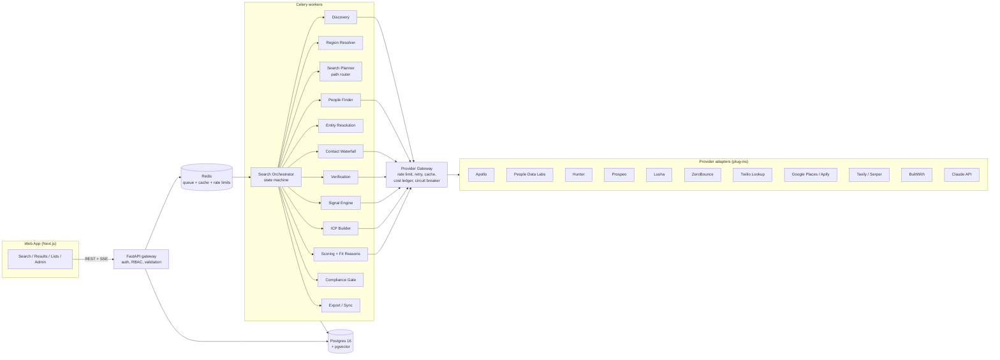
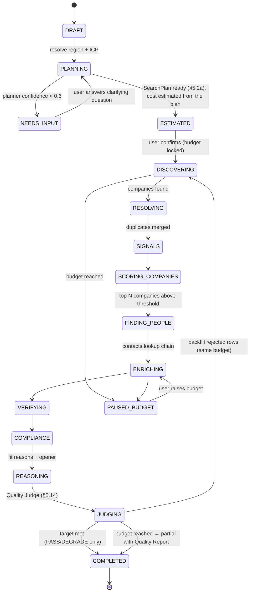

# Sales Navigator: System Design

**Version:** 0.1 (draft for review)
**Date:** 2026-11-10
**Status:** Design is complete enough to start the prototype. Open decisions are listed in §17.

> **Read with [HLD.md](HLD.md) and [LLD.md](LLD.md).** This document records the *reasoning* and decisions. The HLD/LLD are the implementation baseline and **win wherever they differ**. The main updates since this draft: free-first data sources (Brave, Overture, registries, job boards, our own email engine) with the paid providers below as optional plug-ins. India subscription SaaS (Razorpay, GST). A shared global knowledge store, with `workspace_id` only on tenant tables (HLD §7.2).

---

## 0. Design principles (fixed for the whole design)

1. **Precise over large.** 50 verified, well-matched leads beat 500 unchecked ones. Unverified contacts are hidden by default.
2. **Every field has a source and a confidence score.** No value is shown without saying where it came from, when, and how sure we are.
3. **Providers can be swapped.** No business logic depends on any one data vendor. Each vendor is a plug-in.
4. **Every AI claim has evidence.** Every "why they fit" sentence must point to a stored piece of evidence. Claims without evidence are rejected.
5. **The client owns the system.** It runs on the client's keys, servers and database. Nothing depends on the seller's accounts.
6. **Compliance is built in from the start**, not added on later.
7. **Cost is visible before spending.** Every search shows a credit and cost estimate and has a budget cap.
8. **Fair to the customer.** An independent Quality Judge (§5.14) holds back anything the system isn't confident in, and customers pay only for delivered rows.

---

## 1. Where I'm pushing back on the current strategy

| # | Current position | My position | Design response |
|---|---|---|---|
| P1 | "Works for **any** business from just a business input" | The customer profile (ICP) is only as good as what we're given. A website alone gives a guess. **5–20 of the client's best existing customers** is the strongest signal there is. | The intake form asks for seed customers (optional, strongly encouraged). Lookalike search on those seeds is a first-class discovery method. When there are no seeds, the UI shows the ICP as an **editable draft**, not a final answer. |
| P2 | "Most reliable leads **with** contact numbers" | Phone coverage is about 25–60% depending on region. Forcing a number onto every lead produces wrong numbers. | Phone is a field that may be missing and carries a confidence level. Phones are only looked up for leads above a score threshold. The UI never displays an "unknown" phone as a real one. |
| P3 | "**Global** should work" | "Global" can't be listed exhaustively: it means millions of companies and unbounded cost. | "Global" becomes a **ranked list of markets** (matched to the ICP) with a per-country quota and a hard budget. The user sees and can edit the market list before running. |
| P4 | "B2B **and B2C**, same flow" | Individual consumer contact data is legally off-limits in most places (GDPR/DPDP/CCPA/TCPA). | Two modes (§11): B2B, and B2C via **B2B2C** (businesses that reach those consumers) plus audience intelligence. No individual consumer personal data. |
| P5 | "Sell the source code once, works perfectly" | Data providers change their APIs and prices several times a year. Code that's sold once and never maintained will break within months. | Plug-in design plus contract tests that catch breaking changes. **Commercially: sell source + a maintenance retainer.** Don't promise data accuracy in the contract (§16). |
| P7 | "A judge that **removes** rows it isn't confident about" | Agree with the goal. Disagree with three details: (a) **silently** removing rows hides problems and loses good leads, (b) judging **only whole rows** throws away strong leads because of one weak field, (c) an LLM judge on its own isn't reliable and shares the generator's mistakes. | Field-first checks (DEGRADE before REJECT), a `HOLD` review tab, auditable reason codes, deterministic checks before an *independent* LLM judge, calibrated thresholds, no billing for rejected rows, and backfill (§5.14). |
| P8 | Users are startup founders who want to sell "**wherever they can**" | A vague target produces vague leads and wastes credits. Startups win by focusing on a narrow first segment. | The ICP Builder proposes **2–3 starting segments** (industry × size × region) ranked by fit and evidence. Each search targets one segment. A "broad" search is allowed but shown with a warning and a lower expected quality. |
| P6 | "Design everything before the client questions" | Fine, **if** the decisions that are hard to undo are made safely now. | Multi-account support (a `workspace_id` on every row) is built in from day one even if the client uses one account. Adding it later is a rewrite, while having it costs almost nothing. Everything else that depends on the open questions is a config setting. |

---

## 2. Requirements

### 2.1 Functional
| ID | Requirement |
|---|---|
| F1 | A user describes their business (URL and/or text, optional seed customers, optional excluded customers) |
| F2 | The system generates an editable **ICP**: industries, size bands, geographies, buyer roles, pains, buying triggers, exclusions |
| F3 | The user enters any region: a country, state, city, city + radius, several regions, or "global" |
| F4 | The system finds matching **companies** and the **decision-makers** in them |
| F5 | Each person gets a LinkedIn URL, work email, and phone where available, each with a check status and confidence |
| F6 | Each lead gets a **fit score (0–100)** and **3–5 reasons tied to evidence**, plus a suggested opening line |
| F7 | Cost estimate before a run, a budget cap, and a live progress view |
| F8 | Review, filter, save to lists, thumbs up/down, export (CSV/XLSX/Google Sheets/HubSpot/webhook) |
| F9 | Admin: provider keys, lookup-chain order, budgets, users and roles, suppression lists |
| F10 | Compliance: opt-out/suppression list, Do-Not-Call check, delete-on-request, a record of where each contact came from, data retention limits |

### 2.2 Non-functional targets
| Area | Target |
|---|---|
| Speed | First 25 scored companies in under 60 s. 100 fully enriched leads in under 5 min |
| Throughput | 20k enriched leads/day on one 4-vCPU / 16 GB server |
| Reliability | A failed provider call never fails the search: it is retried, then skipped and recorded |
| Credits | Retries never charge twice (idempotency keys + a response cache) |
| Accuracy (measured, §14) | Verified email deliverability ≥ 90% (US/EU), ≥ 80% (APAC). Human-rated fit ≥ 75% in the top 50 |
| Security | Keys encrypted at rest, roles per user, audit log, OWASP ASVS L2 |
| Portability | `docker compose up` on any Linux server. No vendor lock-in for infrastructure |

---

## 3. High-level architecture



**Key idea:** every outside call goes through **one Provider Gateway**. That is where rate limits, retries, caching, cost tracking, circuit breakers and provider metrics live. Pipeline stages never call vendors directly.

---

## 4. The search pipeline (state machine)



- Each stage works in **batches** and saves a checkpoint. A crash resumes from the last checkpoint and never repeats paid calls.
- Results **stream** to the UI over SSE as they arrive, so the user sees companies within seconds.
- **Two-stage filtering keeps costs down:** cheap company-level scoring happens *before* expensive people and contact lookups. Only companies above the threshold (default 60) move on.

---

## 5. Components in detail

### 5.1 ICP Builder
**Input:** website URL, free-text description, seed customers (domains/names), excluded customers, product price point, sales motion (self-serve / inside sales / field / enterprise).

**Process:**
1. Crawl the user's website (≤ 15 pages: home, product, pricing, customers, case studies) and extract the text.
2. Enrich seed customers (firmographics + tech stack) and compute **what they have in common**: industry mode, size distribution, typical technologies, countries.
3. The LLM produces a structured ICP (schema below), with each field marked `inferred_from: website | seeds | user`.
4. The user reviews and edits it. The ICP is **versioned**, and every search records the ICP version it used.

```json
{
  "icp_version": 3,
  "mode": "b2b",
  "industries": [{"name": "Logistics & Supply Chain", "weight": 1.0}],
  "employee_bands": ["11-50", "51-200"],
  "revenue_bands": ["$1M-$10M"],
  "technologies_any": ["Shopify", "WooCommerce"],
  "buyer_personas": [
    {"role": "Head of Operations", "seniority": ["director","vp","head"], "departments": ["operations"], "priority": 1},
    {"role": "Founder/CEO", "seniority": ["owner","founder","c_suite"], "priority": 2, "only_if_employees_lt": 50}
  ],
  "pains": ["manual dispatch", "late deliveries"],
  "buying_triggers": ["hiring ops roles", "new warehouse", "recent funding"],
  "exclusions": {"industries": ["Government"], "domains": ["competitor.com"]},
  "inferred_from": {"industries": "seeds", "pains": "website"}
}
```

### 5.2 Region Resolver
Turns any text into a canonical `GeoScope`:

```json
{ "level": "city", "country_iso2": "IN", "admin1": "Maharashtra", "city": "Pune",
  "lat": 18.52, "lon": 73.85, "radius_km": 25, "geonames_id": 1259229 }
```

- **No geocoding server by default.** A built-in **static place table** (GeoNames: all countries, Indian states/UTs and districts, and cities with population > 5,000, with coordinates; a few MB in Postgres) resolves countries, states, cities and radius searches. Radius uses a haversine distance on stored coordinates. Unknown or very local place names fall back to a geocoding API call (Nominatim public with a strict rate limit, or Google Geocoding as an optional plug-in), and the answer is cached forever.
- Handles **lists** ("Pune, Mumbai and Bangalore"), **groups of countries** (DACH, GCC, ASEAN, EU, Nordics; a fixed lookup table), radius ("within 50 km of Austin"), and **"global"** (P3 → ranked market list).
- **Translation per provider:** each adapter declares how fine-grained its location filter is (country / state / city / lat-lon radius). The resolver chooses the most precise filter the provider supports, then **checks results afterwards** against the GeoScope (company HQ or office location in scope).

### 5.2a Search Planner (path router)

**Purpose:** decide **which discovery path(s)** a search needs *before* any credits are spent. Every later stage (discovery sources, persona plan, contact strategy, cost estimate) follows the plan. Without it, every search would run every path, which wastes credits and mixes the wrong kind of leads.

#### Path catalogue

| Path | When it fits | Discovery sources | Who to contact | Contact strategy |
|---|---|---|---|---|
| **B2B_COMPANY** | Targets are companies with teams (SaaS, agencies, manufacturers, D2C brands, IT services) | Brave (company + LinkedIn snippets), MCA / registries, company websites, paid plug-ins | Persona roles (e.g. Head of Ops, CTO, Founder) | Work email + LinkedIn first, phone only when score ≥ 70 |
| **LOCAL_BUSINESS** | Targets are physical, owner-run businesses (clinics, restaurants, gyms, salons, schools, shops, workshops) | Overture places (on demand), website crawl, Google Places plug-in | Owner / manager | Business phone + WhatsApp Business + website email |
| **LOOKALIKE** | The user gave seed customers | Similarity search over enriched seeds + Brave | Same as the seeds' buyer roles | As B2B_COMPANY |
| **SIGNAL_LED** | The ICP has strong triggers (hiring, funding, expansion, new launch) | Job-board APIs, GDELT, Brave news | Role tied to the trigger (e.g. new ops hire → Head of Ops) | As B2B_COMPANY |
| **B2B2C** | The seller is B2C. Targets are businesses that reach consumers | LOCAL_BUSINESS + B2B_COMPANY, filtered to intermediary categories | Owner / partnerships / category manager | Mixed |
| **AUDIENCE_INSIGHT** | B2C seller who wants to understand consumers rather than contact them | Region data, competitor locations, communities | No contacts | None (report only) |

#### How it decides (rules first, AI only for unclear cases)

1. **Feature extraction** (from ICP + GeoScope + workspace):
   `seller_mode (b2b|b2c)`, `target_size (enterprise|mid|smb|micro)`, `target_is_physical_local` (industry mapped to Overture place categories), `has_seeds`, `trigger_strength`, `geo_level (global|country|state|city|radius)`, `budget`, `enabled_providers`, `plan_limits`.
2. **Deterministic rules** (in `config/planner_rules.yaml`, editable without code), for example:

| Rule | Result |
|---|---|
| `seller_mode = b2c` and the user wants contacts | B2B2C (never consumer contacts) |
| `target_is_physical_local` and `target_size ∈ {micro, smb}` | LOCAL_BUSINESS as primary |
| `target_size ∈ {mid, enterprise}` | B2B_COMPANY as primary |
| `has_seeds` (≥ 5) | Add LOOKALIKE with 30% of the quota |
| `trigger_strength ≥ 0.6` | Add SIGNAL_LED with 20% of the quota |
| `geo_level = radius` or `city` and LOCAL_BUSINESS | Tile the area into map boxes for place queries |
| `geo_level = global` | Ranked market list first (P3), then the paths per market |
| A path's required source is unavailable (no key, plan limit) | Drop it, or swap to the next-best path, and record why |

3. **AI tie-break:** only when the rules give two paths with close scores or the ICP is ambiguous (e.g. "healthcare": hospital chains = B2B_COMPANY, single clinics = LOCAL_BUSINESS). The AI returns a structured choice with a rationale, and the result is validated against the path catalogue.
4. **Confidence check:** if the planner's confidence is below 0.6, the search **asks the user one clarifying question** before spending anything (e.g. *"Do you sell to clinic owners or to hospital chains?"*), with buttons for the options.

#### Output: the `SearchPlan`

```json
{
  "plan_version": 1,
  "paths": [
    {"path": "LOCAL_BUSINESS", "share": 0.7, "sources": ["overture", "website_crawl"], "persona": ["owner", "manager"],
     "contact_strategy": ["business_phone", "whatsapp_business", "website_email"]},
    {"path": "B2B_COMPANY", "share": 0.3, "sources": ["brave", "mca"], "persona": ["founder", "operations_head"],
     "contact_strategy": ["work_email", "linkedin"]}
  ],
  "geo_tiles": 12,
  "expected_yield": {"candidates": 450, "delivered": 120},
  "estimated_cost_inr": 520,
  "confidence": 0.82,
  "rationale": ["ICP industry 'dental clinics' maps to local place categories", "target size micro/smb"],
  "overrides": []
}
```

- The **cost estimate (§5.12) is calculated from this plan**, so the user sees an accurate cost per path.
- The user can see the plan in plain language on the search screen and **override it** (e.g. "B2B only"). Overrides are recorded.

#### Adapting during the search
- After the first batch (~20% of the quota), the planner compares each path's **actual delivered rate** (PASS rows from the Quality Judge per credit spent) with the expected one. Quota moves from weak paths to strong ones, within the same budget.
- Across searches, yield per `(industry, region, path)` is stored and used as starting estimates for the next similar search (a simple Thompson-sampling model per workspace, plus a global one). The planner gets better as the product is used.

Only the paths chosen by the **Search Planner (§5.2a)** run, each with its share of the quota. Within a path, sources run **in parallel**. Results are merged in §5.4.

| Strategy | When | Sources |
|---|---|---|
| Filter search | Always (B2B) | Apollo, People Data Labs, PeakAI |
| Lookalike | Seeds given | PDL similar-company search, pgvector similarity over company description embeddings |
| Local / place search | **Only when the ICP targets local businesses** (clinics, restaurants, shops, gyms, schools) | Overture Maps Places queried **on demand with DuckDB directly from Overture's public GeoParquet files** (bounding-box filter, nothing hosted), results cached in Postgres. An India-only extract can be loaded into the main database for speed. Google Places as an optional paid plug-in |
| Signal-led | Triggers set in the ICP | Job postings (Apollo/TheirStack), news (Tavily/Serper), funding |

The candidate pool is capped (default 5× the requested lead count) so there are always enough companies to score without overspending.

### 5.4 Entity Resolution (merging duplicates)
- **Company key:** the registrable domain (`acme.co.uk`, via `tldextract`). Without a domain: a normalized name plus city, fuzzy-matched (`rapidfuzz` ≥ 92) and then confirmed by phone or address.
- **Person key:** the LinkedIn public identifier. Otherwise `(normalized full name, company domain)`.
- **Field-level merging:** every field keeps all its candidate values with their source. The winning value is chosen by **source reliability × freshness × agreement between sources** (two providers agreeing → confidence goes up).

### 5.5 Signal Engine
Collects **evidence**, saving each item as an `evidence` row with a URL, a snippet and a timestamp:
- Website: what they do, the products they mention, customer types
- Hiring: open roles relevant to the product (e.g. "Logistics Coordinator")
- Funding and news in the last 12 months
- Tech stack (BuiltWith/Wappalyzer)
- Reviews / Google rating (local businesses)
- Growth: headcount trend (from the provider where available)

### 5.6 Scoring
Three layers, combined:

1. **Hard filters** (pass/fail): location in scope, not excluded, not suppressed, industry allowed.
2. **Rule score (0–60):** weighted match on industry, size, tech, persona availability and signals. Fully explainable and tuned per workspace.
3. **LLM judgment (0–40):** the LLM sees the ICP and the company's evidence pack and returns a structured judgment: `fit: strong|medium|weak|no`, `reasons[] {text, evidence_ids[]}`, `risks[]`.

`final_score = rule_score + llm_score`, then **calibrated** using feedback (§5.11) once enough labels exist.

### 5.7 People Finder
For each qualifying company, search for the ICP personas in priority order. Return at most **K people per company** (default 2) to avoid wasting credits. Each person gets a LinkedIn URL, title, seniority and a tenure check (people who changed jobs in the last 3 months are flagged).

### 5.8 Contact Waterfall (lookup chain)
Configured in admin. Runs separately per field. Stops at the first result that **passes checking**.

```yaml
waterfall:
  work_email:
    - provider: apollo        # cheapest / already-paid credits first
    - provider: prospeo
    - provider: hunter
    - provider: pattern_guess # {first}.{last}@domain, only kept if verified "valid"
    verify_with: zerobounce
    accept: [valid]           # "catch_all" → kept but labelled, never "verified"
  mobile_phone:
    only_if_score_gte: 70
    - provider: peakai
    - provider: lusha
    verify_with: twilio_lookup
    accept_line_types: [mobile, fixedVoip]
  linkedin_url:
    - provider: apollo
    - provider: pdl
```

Every attempt is logged as `(provider, cost, result, latency)`, which feeds the provider performance dashboard (§13).

### 5.9 Verification
| Field | Method | Status values |
|---|---|---|
| Email | ZeroBounce/NeverBounce SMTP check | `valid`, `catch_all`, `invalid`, `unknown`, `disposable` |
| Phone | Twilio Lookup (line type, carrier, valid format via `phonenumbers`) | `mobile`, `landline`, `voip`, `invalid` |
| LinkedIn | URL format + name/company match between sources | `matched`, `unconfirmed` |

**Re-check on export:** any email checked more than 14 days ago is checked again before export.

### 5.10 Compliance Gate
- **Suppression list** (emails, domains, phones) per workspace, applied before enrichment, so no credits are spent on suppressed contacts.
- **Do-Not-Call:** US National DNC and India NCPR checks, with phones marked `dnc: true`.
- **Region rules:** EU/UK contacts are flagged as "legitimate interest required". Personal (non-work) emails are excluded by default.
- **Data record:** source, legal basis and collection date stored for every person.
- **Delete-on-request:** an endpoint that deletes a person everywhere and adds them to suppression.
- **Retention:** person data not exported is purged after N days (configurable).

### 5.11 Feedback & Learning
- 👍/👎 on each lead with an optional reason ("wrong industry", "too small", "already a customer").
- Outcome sync from the CRM (replied / meeting / won).
- Rule weights are re-tuned per workspace with logistic regression once there are ≥ 100 labels. Labelled examples are also fed back into the LLM prompt as few-shot examples.

### 5.12 Cost & Credit Manager
- **Estimator:** before a run, `expected_cost = Σ stage × expected volume × provider price × historical hit rate`.
- **Budget lock:** each search has a hard cap. The orchestrator pauses (`PAUSED_BUDGET`) instead of going over it.
- **Cost ledger:** one row per paid call. Reports by workspace, user, provider and search.
- **Cache first:** the gateway checks the cache before any paid call (TTLs: company 90 d, person 30 d, email check 14 d, phone check 30 d).

### 5.13 Provider Gateway & Adapter Interface
```python
class ProviderAdapter(Protocol):
    name: str
    capabilities: set[Capability]          # COMPANY_SEARCH, PEOPLE_SEARCH, EMAIL_FIND, PHONE_FIND, VERIFY_EMAIL, ...
    geo_granularity: GeoGranularity
    async def search_companies(self, q: CompanyQuery) -> Page[CompanyRecord]: ...
    async def search_people(self, q: PeopleQuery) -> Page[PersonRecord]: ...
    async def find_email(self, p: PersonRef) -> FieldResult[str]: ...
    async def find_phone(self, p: PersonRef) -> FieldResult[str]: ...
    def estimate_cost(self, op: Operation, n: int) -> Money: ...
```
The gateway wraps every adapter with: a token-bucket **rate limiter** (Redis), **retry** with jittered backoff (`tenacity`), a **circuit breaker**, a **response cache**, **idempotency keys**, a **cost ledger** entry, and an **OpenTelemetry span**.

**Adding a provider = one file + one config entry + one contract test.**

### 5.14 Quality Judge (fairness layer)

**Purpose:** nothing reaches the customer unless the system is confident in it, and **customers never pay for output we reject.** The judge runs as the last stage before results are delivered (`JUDGING`). It is **independent** of the stages that produced the data.

#### Design rules
1. **The judge is separate from what it checks.** The checks are deterministic code, and the LLM judge uses a *different model and prompt* from the one that wrote the reasons, so the two don't share the same mistakes.
2. **Judge each field first, then the row.** A weak phone number shouldn't throw away a strong lead. Remove the bad field and keep the row (`DEGRADE`). Only drop the row when its *core* fails.
3. **Confidence must be calibrated, not made up.** "0.80" has to mean "correct about 80% of the time" when checked against the gold set (§14). The raw scores are calibrated with isotonic regression.
4. **No silent deletions.** Every rejection keeps its reason codes, is auditable, and shows up in a per-search **Quality Report**.

#### Three layers of checks

**Layer 1: Field checks (deterministic, free or cheap)**

| Field | Checks | Fails → |
|---|---|---|
| Work email | Check status = `valid`. Email domain = company domain (or a known alias). Local part matches the person's name pattern. Not a role account (`info@`, `sales@`) unless allowed. Checked ≤ 14 d ago | `catch_all` → reduced confidence. `invalid/unknown` → field removed |
| Phone | Parses with `phonenumbers`. Country matches the person's or company's location. Line type allowed. Not on DNC (or flagged). ≥ 2 sources agree → bonus | Field removed |
| LinkedIn URL | Valid format. Name in the URL roughly matches the person's name (rapidfuzz). Company/title agree between sources | Field removed, confidence drops |
| Title / persona | Title maps to an ICP persona and seniority. Tenure info not stale (job change < 90 d → flag) | Row → `HOLD` |
| Company | Domain resolves (DNS/HTTP 200). Not parked or for sale. Location in scope. Not excluded or suppressed. Headcount within ICP band (± tolerance) | Row → `REJECT` |

**Layer 2: Row checks (deterministic)**
- **Core completeness:** a valid company + a persona-matched person + at least **one verified way to reach them** (valid email OR verified mobile).
- **Agreement between sources:** company/person facts confirmed by ≥ 2 sources raise confidence. Contradictions (e.g. two providers name different employers) lower it.
- **Freshness:** a weighted age of the row's key fields.
- **Duplicates:** the same person already delivered to this workspace in the last N days → `REJECT` (`DUPLICATE_DELIVERED`). Customers don't pay twice for the same lead.

**Layer 3: Reasoning check (LLM judge, only for rows that pass Layers 1–2)**

For each fit reason, the judge receives the reason text + the evidence snippets it cites + the ICP, and returns:

```json
{
  "reasons": [
    {"reason_id": "r1", "supported": "yes|partial|no", "specific": true, "relevant_to_icp": true}
  ],
  "overall_fit_agrees": true,
  "opener_grounded": true,
  "issues": ["generic_reason", "evidence_outdated"]
}
```

- Unsupported reasons are **removed**. If fewer than 2 supported reasons remain → the row goes to `HOLD`.
- If the judge disagrees with the fit grade → the row goes to `HOLD` and is never auto-delivered.
- The model is configurable (default: a different tier from the generator, e.g. the judge is `claude-opus-5-5` when the generator is `claude-sonnet-5-5`). Calls are batched and cached for cost.

#### Combining the scores

```
row_confidence = calibrate(
    w1 * company_confidence
  + w2 * person_confidence
  + w3 * best_reachable_contact_confidence
  + w4 * reasoning_support_ratio
  + w5 * freshness
)
```

Weights live in `config/quality.yaml`. Calibration is refit whenever the gold set or the feedback labels grow by 20% or more.

#### Decisions

| Decision | Rule (defaults, configurable per workspace) | Customer sees | Billed / counted? |
|---|---|---|---|
| `PASS` | `row_confidence ≥ 0.80`, all core checks pass | Delivered lead with a quality badge | ✅ Yes |
| `DEGRADE` | Row passes but some fields were removed | Delivered, with the removed fields shown as "not found" | ✅ Yes |
| `HOLD` | `0.60 ≤ confidence < 0.80`, or the judge disagrees, or a stale job change | Hidden by default. Visible in a "Needs review" tab. The customer can accept it manually | ❌ No, unless accepted |
| `REJECT` | `< 0.60`, or a hard failure | Not delivered. Counted in the Quality Report with reasons | ❌ No |

#### Fairness guarantees (product-level)
- **No duplicate records per customer:** a record delivered to a workspace is never delivered to it again — across every search, permanently, keyed on stable identity (LinkedIn/email/name+company, or business domain/phone), so a re-resolved row can't slip through. The customer never pays for, or sees, the same lead twice. (LLD §6.12, `delivered_record`.)
- **Pay only for delivered rows:** the delivered count and billing/credits count only `PASS` + `DEGRADE` (+ any `HOLD` the customer accepted). Provider costs for rejected rows are absorbed into the system's cost, shown internally only.
- **Backfill:** when rejections leave a search short of its target, the orchestrator goes back to discovery to replace them, **within the same budget**. If the budget runs out, the search finishes with a clear "delivered 42 of 50 — budget reached" message instead of padding with low-quality rows.
- **Quality Report per search:** candidates found, accepted, held and rejected, the top rejection reasons, the average confidence, and the verified-contact rate.
- **Post-delivery guarantee:** if a delivered email bounces (reported by the CRM or a sending-tool webhook) within 30 days, the row is credited back automatically and the bounce feeds into calibration.

#### Watching the judge itself
- **False-reject rate:** a monthly sample of 50 `REJECT`/`HOLD` rows is reviewed by a person. If more than 15% were actually good, the judge is too strict and the thresholds are retuned.
- **Precision of delivered rows**, measured against the gold set and bounce/feedback data. Target ≥ 90% for `PASS` rows.
- Reason codes are tracked on the dashboard (§13), so the client can see *why* rows are rejected (e.g. "catch-all domains in Germany"), which points to which provider to change.

---

## 6. AI layer

| Task | Model (configurable) | Output |
|---|---|---|
| ICP generation | `claude-sonnet-5-5` (fallback `claude-haiku-5-5`) | ICP JSON (validated by Pydantic) |
| Website / evidence extraction | `claude-haiku-5-5` | Structured facts |
| Company fit judgment | `claude-sonnet-5-5` | `{fit, score, reasons[{text, evidence_ids}], risks}` |
| Opening line | `claude-sonnet-5-5` | 1–2 sentences, must cite one piece of evidence |
| Quality Judge: reasoning check (§5.14) | `claude-opus-5-5` (must differ from the generator) | `{reasons[{supported, specific, relevant}], overall_fit_agrees, opener_grounded, issues[]}` |

**Guardrails:**
- All outputs use **structured tool/JSON schemas** and are checked with Pydantic. Invalid output → one retry → otherwise the lead is marked `needs_review`.
- **Evidence citations are enforced:** a reason whose `evidence_ids` aren't in that company's evidence pack is **dropped**. This blocks invented facts.
- Prompts are **versioned files** (`prompts/fit_judgment/v3.md`), and the prompt version is saved on every result.
- **Evaluation set:** 200 hand-labelled company–ICP pairs. CI fails if fit agreement drops more than 3 points after a prompt or model change.
- Prompt caching is used for the ICP and system prompt (the same across a whole search), which cuts cost and response time. **Full caching + guardrail spec: [PROMPT_CACHING_AND_GUARDRAILS.md](PROMPT_CACHING_AND_GUARDRAILS.md)** (cached prefix per task, prompt-injection fencing, structured outputs, refusal handling).
- Bulk scoring uses the Batch API when the user picks "overnight" mode.

---

## 7. Data model (Postgres)

Every table has `workspace_id` (P6), `created_at` and `updated_at`.

```
workspace(id, name, plan, settings_json)
user(id, workspace_id, email, role[owner|admin|member|viewer], ...)
provider_credential(id, workspace_id, provider, encrypted_key, status, last_checked_at)
icp(id, workspace_id, version, mode[b2b|b2b2c], body_json, created_by)
search(id, workspace_id, icp_id, geoscope_json, status, budget_cents, spent_cents, target_count, progress_json)
search_plan(id, search_id, version, paths_json, confidence, rationale_json, overrides_json, decided_by[rules|ai|user], created_at)
path_yield(id, workspace_id NULL=global, industry, region, path, candidates, delivered, cost_cents, updated_at)   -- planner learning
company(id, workspace_id, domain UNIQUE(ws,domain), name, industry, employees_band, hq_geo, description, embedding vector(1024))
company_field(id, company_id, field, value_json, source, confidence, observed_at)   -- every candidate value + source
person(id, workspace_id, company_id, full_name, title, seniority, linkedin_id, geo, tenure_start)
contact_point(id, person_id, kind[work_email|personal_email|mobile|direct_dial|linkedin],
              value, source, verify_status, confidence, verified_at, dnc bool)
evidence(id, company_id, kind[website|job|news|funding|tech|review], url, snippet, observed_at)
lead(id, search_id, company_id, person_id, rule_score, llm_score, final_score, fit, reasons_json, opener, status,
     row_confidence, quality_decision[pass|degrade|hold|reject], billable bool, delivered_at)
judgment(id, lead_id, layer[field|row|reasoning], check_code, passed bool, detail_json, judge_model, judge_version, at)
quality_report(id, search_id, found, passed, degraded, held, rejected, top_reasons_json, avg_confidence, verified_contact_rate)
credit_adjustment(id, workspace_id, lead_id, reason[bounce|hold_rejected|duplicate], credits, at)
feedback(id, lead_id, user_id, verdict, reason, outcome)
suppression(id, workspace_id, kind[email|domain|phone], value_hash)
provider_call(id, workspace_id, search_id, provider, operation, cost_cents, cache_hit, status, latency_ms, idempotency_key)
audit_log(id, workspace_id, user_id, action, target, at)
```

Indexes: `(workspace_id, domain)`, `(workspace_id, linkedin_id)`, GIN on `reasons_json`, IVFFlat on `embedding`. Suppression values are stored **hashed**, so the opt-out list itself doesn't hold readable personal data.

---

## 8. API (main endpoints)

```
POST   /v1/icp/draft                 {url, description, seeds[], exclusions[]} → ICP draft
PUT    /v1/icp/{id}                  edit → new version
POST   /v1/geo/resolve               {"text": "Pune + 30km"} → GeoScope[]
POST   /v1/searches                  {icp_id, geo, target_count, budget} → estimate (status=ESTIMATED)
GET    /v1/searches/{id}/plan        SearchPlan in plain language + JSON
PUT    /v1/searches/{id}/plan        user override (e.g. "B2B only") → re-estimate
POST   /v1/searches/{id}/clarify     answer the planner's clarifying question
POST   /v1/searches/{id}/run         confirm → starts the pipeline
GET    /v1/searches/{id}/stream      SSE progress + leads
GET    /v1/leads?search_id&min_score&verified_only&decision=pass,degrade
GET    /v1/searches/{id}/quality-report
POST   /v1/leads/{id}/accept         accept a HOLD row (becomes billable)
POST   /v1/leads/{id}/bounce         report a bounce → automatic credit-back + calibration signal
POST   /v1/leads/{id}/feedback
POST   /v1/exports                   {lead_ids|search_id, format[csv|xlsx|sheets|hubspot|webhook]}
POST   /v1/compliance/suppress | /v1/compliance/erase
GET    /v1/admin/providers/health    hit rate, cost per verified contact, error rate, by provider
```
An OpenAPI spec is generated automatically. A public API key per workspace allows integrations.

---

## 9. Web app (screens)
1. **Onboarding / ICP:** URL + seeds → editable ICP card (chips, weights, personas).
2. **New search:** region box (autocomplete, map preview, editable market list for "global"), target count, budget, **live cost estimate**.
3. **Live results:** companies stream in, each expands to people. Filters (score, verified only, has phone, signals).
4. **Lead detail:** score breakdown (rule vs AI), reasons with **clickable evidence links**, contact points with verify badges and sources, opener.
5. **Lists & exports.**
6. **Admin:** provider keys with a "test connection" button, drag-to-reorder lookup chain, budgets, users, suppression upload, **provider performance dashboard**.

---

## 10. Technology stack

| Layer | Choice | Why |
|---|---|---|
| Language | Python 3.12 | As requested. Best data/AI ecosystem |
| API | FastAPI + Pydantic v2 | Typed, fast, auto OpenAPI |
| Workers | Celery + Redis | Mature, well known, so the client's developers can maintain it. (Temporal is stronger but adds work for the client to run) |
| DB | Postgres 16 + pgvector | One database for relational data and similarity search |
| ORM / migrations | SQLAlchemy 2 + Alembic | Industry standard |
| HTTP | httpx (async) + tenacity | Async fan-out + retries |
| Matching | tldextract, rapidfuzz, phonenumbers, email-validator | Proven libraries |
| LLM | Anthropic Python SDK | Structured outputs, prompt caching, Batch API |
| Frontend | Next.js + TypeScript + Tailwind + shadcn/ui | A professional UI the client can extend |
| Auth | Built-in JWT + optional OIDC (Google/Microsoft SSO) | Works for single-account and SaaS |
| Secrets | Fernet/AES-GCM envelope encryption, master key from env/KMS | Provider keys never stored in plain text |
| Observability | OpenTelemetry → Grafana/Tempo or any OTLP backend, Sentry, structured JSON logs | Vendor-neutral |
| Packaging | Docker Compose (api, worker, beat, web, postgres, redis, nominatim optional) | One-command install |

---

## 11. Business modes

| Mode | Target | Discovery | Contacts |
|---|---|---|---|
| **B2B** | Companies + decision-makers | Filter, lookalike and signal search | Work email, direct/mobile phone, LinkedIn |
| **B2B2C** (for B2C sellers) | Businesses that reach the end consumer (retailers, clinics, gyms, schools, societies, distributors, event organisers, influencers' agencies) | Local place search + filter search | Business phone/email, owner/manager LinkedIn |
| **Audience insight** (B2C add-on) | Where the consumers are | Region demographics, competitor locations, community/influencer lists | **No individual consumer personal data** |

The ICP Builder picks the mode automatically from the business type, and the user can change it.

---

## 12. Security
- Roles: owner / admin / member / viewer. Every query is scoped by `workspace_id`, with Postgres row-level security as a second layer of protection.
- Provider keys are encrypted and never returned by the API (masked). A "test connection" check is available.
- Rate limiting per user and per API key. Audit log for exports, deletions and key changes.
- Personal data is encrypted at rest (disk + column-level for contact points). TLS everywhere.
- Dependency scanning (pip-audit, npm audit) and SAST (bandit, semgrep) in CI.

---

## 13. Observability & provider performance dashboard
For each provider, region and field:
- **Hit rate** (found / attempted)
- **Verified rate** (valid / found)
- **Cost per *verified* contact**: this is the number that decides the lookup-chain order
- Latency p50/p95, error rate, circuit-breaker state
- **Quality Judge:** pass/degrade/hold/reject mix, top reject reason codes by provider and region, false-reject rate from the human review sample, bounce rate on delivered rows

This dashboard lets the client **prove** data quality and reorder the lookup chain using real numbers instead of guesses.

---

## 14. Testing & accuracy proof

| Layer | Tooling |
|---|---|
| Unit | pytest, ≥ 85% coverage on the core (merging, scoring, lookup chain, compliance) |
| Provider contract tests | Recorded responses with `vcrpy` (run free in CI). A nightly live test with tiny budgets catches vendor API changes |
| Pipeline integration | Fake providers with predictable results + Postgres/Redis in Docker |
| LLM evaluation | 200 labelled pairs, with a fit-agreement threshold that gates CI |
| Search Planner evaluation | 150 labelled ICP + region cases (SaaS, agencies, clinics, restaurants, D2C, B2C sellers, ambiguous "healthcare") with the correct primary path. CI checks ≥ 90% correct primary path and that every ambiguous case triggers a clarifying question |
| Quality Judge evaluation | Labelled set of good and bad rows (including deliberately broken ones: wrong employer, bounced email, unsupported reason). CI checks judge precision ≥ 90% on PASS and false-reject rate ≤ 15%. Calibration curve plotted on every release |
| End-to-end | Playwright on the main user flows |
| Load | Locust: 20k leads/day profile |
| **Accuracy benchmark** | A **gold set** of 200 manually verified contacts per target region (emails sent and bounces tracked, numbers called). Run quarterly. This is the document you hand to the client as proof |

---

## 15. Deployment

```
docker-compose.yml
  web        Next.js (port 3000)
  api        FastAPI / uvicorn (port 8000)
  worker     Celery (concurrency autoscale 4–16)
  beat       Celery beat (re-checks, retention purges, nightly contract tests)
  postgres   16 + pgvector (volume, daily pg_dump backups)
  redis      7 (AOF on)
  caddy      reverse proxy + automatic HTTPS
  (no geocoding or place-data server: static GeoNames table + on-demand Overture queries, see §5.2/§5.3)
```
- Minimum server: 4 vCPU / 16 GB / 100 GB SSD (Hostinger VPS, AWS, DigitalOcean or on-prem).
- `.env.example` documents every setting. `make setup` handles migrations, seed data, the first admin user and a key-check wizard.
- Upgrades: versioned releases, Alembic migrations, zero-downtime rolling restarts of the API and workers.

---

## 16. Repository layout

```
sales-navigator/
  backend/
    app/
      api/            # FastAPI routers
      core/           # config, security, db, logging
      domain/         # models, schemas (Pydantic), enums
      pipeline/       # orchestrator + stages (icp, geo, planner, discovery, resolution, signals, scoring, people, waterfall, verify, compliance, reasoning, judge)
      quality/        # field_checks.py, row_checks.py, reasoning_judge.py, calibration.py, decisions.py, report.py
      providers/      # base.py, gateway.py, apollo.py, pdl.py, hunter.py, prospeo.py, lusha.py, zerobounce.py, twilio.py, places.py, tavily.py, anthropic_llm.py
      prompts/        # versioned prompt files
      services/       # cost, export, feedback, crm
      workers/        # celery app + tasks
    migrations/
    tests/            # unit, contract (cassettes), integration, eval
  frontend/           # Next.js app
  deploy/             # docker-compose, Caddyfile, backups
  docs/               # SYSTEM_DESIGN.md, INSTALL.md, ADMIN.md, ADD_A_PROVIDER.md, API.md, COMPLIANCE.md
  config/             # waterfall.yaml, region_groups.yaml, scoring_weights.yaml, quality.yaml, planner_rules.yaml
```

### What goes in the client contract (and what doesn't)
✅ Software behaviour: pipeline stages, check statuses, budget enforcement, uptime of their own deployment, the defined NFRs
✅ Measured accuracy on the gold set, at handover, for the agreed regions
❌ Promises about third-party data accuracy or coverage
❌ Promises that vendor APIs and prices won't change (covered by a maintenance retainer instead)

---

## 17. Open decisions (each has a default, so the build isn't blocked)

| # | Decision | Default until decided | Impact if it changes |
|---|---|---|---|
| D1 | Client's target regions | ✅ **Subscription market decided 2026-11-10: India** (₹ pricing, GST, Razorpay subscriptions, DPDP Act, TRAI/NCPR). Lead regions still default to India-first + global | Changes provider choice (e.g. Cognism for the EU) and the gold set |
| D2 | Internal tool vs resold SaaS | ✅ **Decided 2026-11-10:** the client runs it as a **multi-account monthly-subscription SaaS** for its own customers (target 100–500) | Needs subscription billing (Stripe/Razorpay), plan limits, per-account data separation, and data-licensing review (Brave storage rights; paid plug-ins licensed for resale or customer-supplied keys) |
| D3 | UI scope | Full Next.js app | A smaller admin-only UI saves ~1.5 weeks |
| D4 | Hosting | Client's VPS via Docker Compose | Kubernetes Helm chart if they need it |
| D5 | Launch provider set | Apollo + Prospeo + Hunter + ZeroBounce + Lusha + Twilio + Google Places + Tavily + Claude | Swap adapters only |
| D6 | CRM | HubSpot + Google Sheets | Each extra CRM ≈ 2–3 days |
| D8 | Quality Judge borderline rows | ✅ **Decided 2026-11-10:** keep the HOLD review tab (0.60–0.80 hidden by default, not billed unless the customer accepts) | — |
| D7 | Languages | English UI and outputs | Multilingual outputs are an LLM setting, UI translation needs i18n work |

---

## 18. Risks

| Risk | Likelihood | Mitigation |
|---|---|---|
| Vendor API/price changes | High | Plug-in adapters, nightly contract tests, maintenance retainer |
| Vendor terms forbid the use case | Medium | Client signs up with each vendor directly. Legal review of terms before choosing D5 |
| Poor coverage in some regions | High (APAC/MENA phones) | Regional providers, local place search, honest coverage shown in the UI |
| AI invents fit reasons | Medium | Enforced evidence IDs, independent Quality Judge, evaluation set gating CI |
| Judge too strict (good leads lost, slow searches) | Medium | Field-first DEGRADE, HOLD tab, monthly false-reject review, thresholds configurable per workspace |
| Cost overruns | Medium | Estimate first, budget lock, cache, phone lookups only above a score threshold |
| Privacy complaint / regulator | Low–Medium | Compliance gate, delete-on-request, record of sources, retention purge, no consumer personal data |
